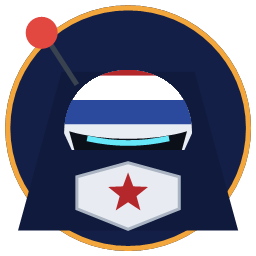
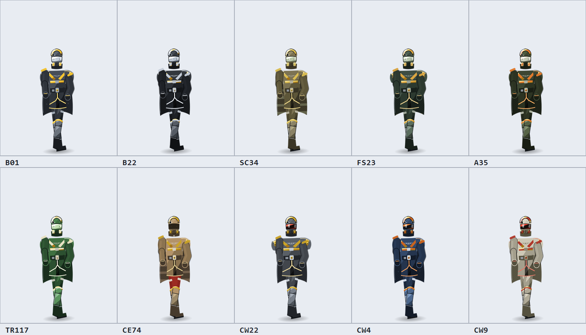

# 绝地潜兵桌宠 · HelldiverPet

一只常驻 Windows 桌面的绝地潜兵（Helldiver 2）。透明置顶、不抢焦点、
只有身上那点像素接收鼠标，其余区域全部穿透 —— 不会挡住你干活。

<p align="center">
  
</p>

<p align="center">
  <b>Windows x64 · 免配置 · 开源免费</b><br>
  <sub>非官方玩家作品，与 Arrowhead / Sony 无关</sub>
</p>

---

## 下载

**→ [Releases 页面下载最新测试版](https://github.com/leerogerstheman/HelldiverPet/releases)**

| 文件 | 说明 |
| --- | --- |
| `HelldiverPet-<版本>-portable.exe` | **免安装版**，双击即用，推荐先试这个 |
| `HelldiverPet Setup <版本>.exe` | 安装版，装完有桌面快捷方式 |

不需要额外装 Node 或 Electron。未做代码签名，Windows 首次运行可能弹 SmartScreen，
选「仍要运行」即可。

> 当前状态：**测试版（beta）**。功能能完整跑通，造型细节还在抠，欢迎开
> [issue](https://github.com/leerogerstheman/HelldiverPet/issues) 拍砖。

## 从源码跑

```bash
git clone https://github.com/leerogerstheman/HelldiverPet.git
cd HelldiverPet
npm install
npm start
```

> npm 若跳过了 Electron 的 postinstall，手动补一次：
> `node node_modules/electron/install.js`
>
> Windows PowerShell 下 `npm.ps1` 常被执行策略拦掉，用 `npm.cmd` 代替。

打包成 Windows 可执行文件：

```bash
npm run dist
```

产物在 `release/`：一个 NSIS 安装包 + 一个免安装的 portable exe。

---

## 装甲皮肤

形象按 [Helldivers Wiki](https://helldivers.wiki.gg/wiki/Armor) 上的装甲套装做的，
**10 款**可在设置面板或右键菜单里切换，**点一下桌宠立刻换装**：

<p align="center">
  
</p>

| 皮肤 | 类型 | 特点 |
| --- | --- | --- |
| **B-01 战术型** | 中甲 · 默认 | 深黑装甲壳 + 标志性的**双黄条** + 封闭式镜面面罩 |
| **B-22 模范公民** | 中甲 | 全黑金属质感 + 冷银色描边，单条纹 |
| **SC-34 渗透者** | 轻甲 | 卡其土黄配色 + 军绿条纹披风 |
| **FS-23 战斗大师** | 重甲 | 墨绿厚重板甲 + 金铜描边，体型加宽 |
| **A-35 侦察兵** | 中甲 | ODST 联动配色：暗橄榄绿 + 橙色描边 |
| **TR-117 阿尔法指挥官** | 中甲 | 致敬彩蛋：经典绿甲 + 米白描边 + 鹰徽披风 |
| **CE-74 破拆者** | 轻甲 | 卡其板甲 + **绯红内衬与腿甲** + **全盔防毒面具**（圆护目镜 + 滤罐） |
| **CW-22 科迪亚克** | 重甲 | 深灰板甲 + **红色目镜**（熊眼）+ 浅灰裙甲，体型最敦实 |
| **CW-4 极地游侠** | 轻甲 | 海军蓝装甲 + 橙色描边 + 橙红目镜 |
| **CW-9 白狼** | 中甲 | 米白板甲 + 黑色胸板 + **红色细描边** + 红目镜 |

后 4 款的配色直接取自 wiki 上各自的 `Armor Set Image`（正面渲染图），存在
`.ref/armor-*.png` 逐个看图还原，不是凭空编的色板。

实现上，皮肤**不复制 SVG**：所有部件只用语义 class（`.pa` / `.pt` / `.pv` …），
每款皮肤就是一组 CSS 变量。换皮肤 = 换一个 class。

## 武器

**6 把**，同样在设置面板或右键菜单里切换：

| 武器 | 剪影特征 |
| --- | --- |
| **标准步枪** | 默认，通用配置 |
| **MG-43 通用机枪** | 直筒枪身 + **机身下方直线弹匣** |
| **GR-8 无后坐力炮** | **厚如方砖的机身** + 顶部弹鼓 + 短粗炮管 |
| **FLAM-40 火焰喷射器** | **极细长喷管** + 身后燃料罐 |
| **GL-21 榴弹发射器** | **又粗又短的炮管** + 大弹鼓 |
| **APW-1 反器材步枪** | **超长细枪管** + 消焰器 + 两脚架 + 大瞄准镜 |

剪影对照 wiki 上的官方战略配备图标（`Stratagem Icon Background` 系列 SVG，
本地存 `.ref/ic-*.svg`）绘制 —— 武器页面本身没有配图，图标反而是最准的侧面剪影来源。

六把武器共用同一个挂点和坐标系，只靠 CSS 显示当前那把，所以加新武器只要往
`WEAPONS` 对象里加一段 SVG，不用动任何动画。

## 造型对照

形象不是凭印象画的。先用 MediaWiki API 把 B-01 Tactical 页面上的图全列了一遍，
找到 **v4（游戏当前版本）** 的官方渲染图，以及一张**正面视角**的合成图，存到
`.ref/`（仅本地参考，不进安装包）：

```
ref-helmet-v4.png   B-01_Tactical_v4_Helmet_Render.png    头盔 3/4
ref-body-v4.png     B-01_Tactical_v4_Armor_Render.png      身体 3/4
ref-set1.png        B-01_Tactical_Armor_Set_Image.png     正面 ← 最关键
```

前两版只给了 3/4 视角，光看它会把胸口和腰部看扁。正面图一上，立刻看出
两处之前完全没画对：

**胸部** —— 两条**黄色斜带**从肩部向内下收成 V，中间嵌一枚**银色翼形胸徽**，
下方还有一道横向黄带。我之前画的是一块居中的圆盾牌，和原版差得最远。

**腰部** —— 腰带下面垂着一整块**裙甲**，四周是**很亮的黄色描边**、正中开叉。
这块板件是 B-01 的标志性结构，我前面两版都直接漏掉了。

**头部** —— 顶部是**一整条很宽的亮黄横带**（不是几根细线）；面罩底边是
**带 V 形缺口的锐角折线**（不是平滑弧带）；两侧的呼吸罩格栅是**黄色框内的
银白竖栅**；侧面是骷髅徽记 + 机械阀。

**胸徽**分三步才对上：

1. 把正面图那块区域**放大 11 倍**（`.ref/zoom-badge.png`），才看清它不是一只展翅的鸟，
   而是 Super Earth 的**「飞行员翼章」**——中央骷髅，两侧各一组羽片，下方一道横条。
2. 骷髅本身又单独去查了官方符号图（[Helldivers 2 Symbol](https://logos-world.net/wp-content/uploads/2024/11/Helldivers-2-Symbol.png)），
   发现是**几何化**的，和常见卡通骷髅完全不同。取黄色像素包围盒 → 缩到 620px 打 0.1 网格
   → 逐顶点读坐标（`.ref/se-grid.png`），再按原图 1854×1920 的比例映射到本地空间。
   特征：顶部是**平的多边形山尖**、两侧在眼窝高度各伸出一个**尖刺**、
   **正圆**眼窝、下方一个**带缺口的小三角**当鼻部。
3. 翅膀再单独放大 22 倍（`.ref/wing-zoom.png`）——羽片是**两片平行的**
   （一片长主羽 + 一片约三分之一长度的短副羽），**不是三片扇形**。
   我先前按三片扇形画，结构就错了。

> 参考图版权归 Helldivers Wiki / Sony / 各站所有，只作本地对照，不随程序分发。

## 它能做什么

| 交互 | 反应 |
| --- | --- |
| **左键点头盔** | 立正敬礼 + 冒一句台词 |
| **左键点身体** | 原地跳一下 + 落地扬尘 |
| **双击** | 投送战略配备（8 方向输入码 → 轨道打击），**有概率换成一个大场面特效** |
| **按住拖动** | 把你拎起来（披风乱飞、双腿下垂） |
| **甩手一扔** | **带着惯性飞出去**，撞到屏幕边缘会弹一下，松手会掉回地面 |
| **滚轮** | 无级缩放 50% – 200% |
| **右键** | 完整菜单：动作 / 大场面 / 皮肤 / 武器 / 各种开关 / 退出 |
| **鼠标移动** | **他一直看着你** —— 头跟着转，面罩上的镜面高光跟着挪 |
| **悬停** | 察觉到你，姿态微微前倾 |
| **闲置 45 秒** | 打瞌睡，姿势变成放松的待机 |
| **屏幕边缘探头** | 藏到屏幕边上只露一点，鼠标靠近才冒头 |

### 拟人化

这一版补的几件「让它像个活物」的事：

| 功能 | 表现 |
| --- | --- |
| **视线跟随** | 头朝光标方向转最多 9°，面罩高光同步位移。潜兵是正面视角、镜面面罩看不见眼睛，所以靠「转头 + 镜面反光移动」来表达它在看你 |
| **抛掷物理** | 甩出去的速度换算成初速度，带着重力飞，撞墙反弹，落地压扁再弹起。落地位置自动对齐工作区底部 |
| **士气** | 0–100 三格指示器。互动会涨（点头盔 +6、点身体 +4、敬礼 +6），独处每 30 秒掉 1 点。低了会抱怨，高了会来劲 |
| **屏幕边缘探头** | 窗口贴到屏幕右边缘，桌宠缩进去只露一条边，鼠标进入 340px 范围才滑出来 |
| **专注计时** | 25 / 50 分钟，倒计时常驻左上角，最后 10 秒变红闪烁，到点拉警报。结束时间写进设置，重启后接着算 |

### 大场面特效

右键菜单里直接触发，双击也有概率随机抽到：

| 特效 | 表现 |
| --- | --- |
| **轨道炮击** | 红色准星收束 → 光束贯穿 → 震屏 + 火星 |
| **鹰击空袭** | 一道鹰影横穿屏幕，途中三轮地面爆炸 + 冲击环 |
| **HMG 火力网** | 架起加特林，枪管高速旋转 + 枪口焰 |
| **导弹雨** | 七枚火箭划出弧线依次砸落，每枚一个火球 |
| **申请晋升** | `PROMOTED` 盖章 + 五彩纸屑雨 + 欢呼 |
| **注射提神剂** | 绿色能量罩从脚底升起包裹全身 |

台词共 160+ 条，分中文 / English 两套，并按场景分流（打招呼 / 点头盔 / 被拖 /
犯困 / 晋升 / 被扔 / 落地 / 士气低 / 士气高 / 探头 / 专注开始 / 专注结束）。音效全部是 Web Audio 现场合成的，不依赖任何音频文件。

其它：托盘常驻、沿任务栏随机巡逻、设置面板、开机自启、`Ctrl+Shift+D` 显隐。

## 使用

启动后它会出现在主屏幕右下角。想放哪就拖着放哪 —— 拖到屏幕边缘时它会自动收住，
不会把你拖丢。

| 快捷键 | 作用 |
| --- | --- |
| `Ctrl + Shift + D` | 显示 / 隐藏桌宠 |
| `Esc` | 关掉当前气泡 |

托盘图标上右键是完整菜单。

## 结构

```
src/
├── main/
│   ├── main.js         窗口、托盘、IPC、全局快捷键、开机自启
│   ├── preload.js      contextBridge 桥接（contextIsolation 开启）
│   ├── settings.js     settings.json 读写
│   └── logger.js       写文件的日志（GUI 程序写 stdout 会 EPIPE）
├── renderer/
│   ├── pet.html/.css/.js    桌宠窗口
│   ├── helldiver.js        矢量形象（纯 SVG 路径，零图片素材）
│   ├── quotes.js           台词库 + 战略配备码
│   ├── audio.js            Web Audio 现场合成音效
│   └── settings.html/.css/.js  设置面板
build/                  图标（由 tools/make-icon.ps1 生成）
tools/make-icon.ps1     GDI+ 生成图标
```

形象是纯手写 SVG，任意缩放不糊，打包体积也小。

## 调试开关

```bash
npm start -- --dev        # 打开 DevTools
npm start -- --trace      # 往日志里打窗口位置/尺寸
npm start -- --settings   # 启动即打开设置窗口
npm start -- --opaque     # 不透明窗口（排查透明合成问题）
npm start -- --nofilter   # 禁用 SVG 滤镜
```

另外两个出图开关，**打包后的 exe 同样可用**（自测要的就是打包版行为）：

```bash
npm start -- --shot <输出png> <延迟ms> <状态类> <缩放> <皮肤> <特效> <武器>
npm start -- --html <本地html路径>    # 加载任意页面再截图，做参考图拼版用
```

日志在 `%APPDATA%\HelldiverPet\logs\helldiver-pet.log`。

> 正常启动时日志基本是空的 —— `did-finish-load` 和位置追踪都只在 `--trace` 下才写。
> **没日志 = 渲染进程没报错**，这是正常状态，不是故障。

## 踩过的坑（留给以后改的人）

几个在 Windows 上真实踩到、且不看代码很难猜的问题：

1. **`win.getPosition()` 返回的是数组 `[x, y]`，不是 `{x, y}`。**
   拿它当对象解构，`pos.x` 就是 `undefined`，后续坐标运算全变 `NaN`，
   `setPosition` 直接抛 "conversion failure"。要 `{x, y}` 得用 `getBounds()`。

2. **`resizable: false` 的窗口不能靠反复 `setPosition` 移动。**
   每调一次，无边框窗口的宽度就会累积变大（实测 300 → 1800）。
   解决：去掉 `resizable: false`（无边框窗口本来就没有拖拽手柄），
   改用 `setMinimumSize`/`setMaximumSize` 锁尺寸，移动一律走
   `setBounds({x, y, width, height})` 显式带尺寸。

3. **透明置顶窗口在部分显卡 / 虚拟机上会直接把渲染进程搞崩**
   （`render-gone: crashed`，页面反复自动重载，桌宠一片空白）。
   `app.disableHardwareAcceleration()` + `--disable-gpu` 走软件渲染即可，
   桌宠负载很轻，完全感觉不到。

4. **GUI 程序别往 stdout 写日志。** 父进程的管道一断，
   `console.log` 抛 `EPIPE`，反而把主进程带崩。统一写文件。

5. **别用 `scale(-1, 1)` 做朝向翻转。** 胸口盾牌上的 `LIBERTY` 会变成镜像。
   改成轻微侧倾表现行走方向。

6. **巡逻循环是 `async` 的，IPC 往返期间 `setInterval` 会继续触发。**
   不加锁会堆积成倍的实际移动速度；就算加了锁，直接 `Math.round(speed * dt)`
   也会因为取整偏快。用小数累加器 + `Math.trunc`。

7. **SVG 上做 CSS transform 必须显式写 `transform-box` / `transform-origin`。**
   SVG 元素的 `transform-origin` 默认是 `50% 50%`，而百分比是相对**最近的
   SVG 视口**解析的 —— 不写就是绕 viewBox 中心转，躯干会被整个甩飞。

8. **`setPointerCapture` 会重定向 `pointerup` 的 `event.target`。**
   要判断「点的是头还是身体」，必须在 `pointerdown` 时就把部位记下来。

9. **SVG 的 `<clipPath>` 里 `id` 是全局的**，加披风裁剪时注意别和已有的
   `helmetClip` 撞名。披风图案不裁剪的话会溢出到身体两侧变成条纹梯子。

10. **`.ps1` 脚本里只要有中文，就必须存成 UTF-8 with BOM。**
    PowerShell 5.1 读到无 BOM 文件会按系统 ANSI（中文机器上是 GBK）解码，
    中文字节序列有可能把后面的换行符吃掉，两行代码被并成一行，脚本结构被改写。
    最坑的是它**不报错**：拼图脚本因此安安静静画出一张纯色空白图，
    看上去像绘图逻辑有问题，其实是一行中文注释把整个 for 循环吃掉了。
    `tools/` 下所有脚本都带 BOM，新增脚本照做。

11. **正常启动时日志是空的。** `did-finish-load` 和窗口位置追踪都只在 `--trace`
    下才写，所以「没有新日志」等于「渲染进程没报错」，别当成启动失败去查。

12. **主进程的 `settings:set` 是白名单式的，漏掉的字段会被静默丢弃。**
    加新设置项时必须同步改那个白名单，否则 `api.setSettings()` 看起来调用成功了，
    值却根本没存进 `settings.json` —— 而且不报错。踩过两次：
    第一次是「专注计时」存不进结束时间，1 秒后就被判定为「时间到」直接拉警报；
    第二次是「探头模式」开关点了没反应。排查这类问题先看
    `%APPDATA%\HelldiverPet\settings.json` 里字段在不在。

13. **`applySettings` 会顺手把 `--scale` 重置成配置里的值。**
    截图模式（`--shot`）用 `--scale` 放大舞台来出图，但截图期间只要触发了任何
    设置写入（比如「开始专注」会存一次设置），`applySettings` 就会跑一遍，
    把 `--scale` 覆盖回配置值，截出来的大小就悄悄变了 —— 还不容易发现，
    因为渲染本身完全正常。解决：加一个 `zoomOverride` 覆盖层，
    截图时走 `petFx.zoom()` 而不是直接写 CSS 变量。

## 资料来源

- [Helldivers Wiki — Armor](https://helldivers.wiki.gg/wiki/Armor)：装甲套装代号、
  被动技能、轻/中/重甲分类，皮肤的配色据此还原
- [CE-74 破拆者](https://helldivers.wiki.gg/wiki/CE-74_Breaker)、
  [CW-22 科迪亚克](https://helldivers.wiki.gg/wiki/CW-22_Coyote)、
  [CW-4 极地游侠](https://helldivers.wiki.gg/wiki/CW-4_Polar_Ranger)、
  [CW-9 白狼](https://helldivers.wiki.gg/wiki/CW-9_White_Wolf)：
  各自页面的 `Armor Set Image` 正面渲染图，后 4 款皮肤按图还原（CE-74 的全盔
  防毒面具也照着这张图做的）
- [MG-43](https://helldivers.wiki.gg/wiki/MG-43) / [GR-8](https://helldivers.wiki.gg/wiki/GR-8) /
  [FLAM-40](https://helldivers.wiki.gg/wiki/FLAM-40) / [GL-21](https://helldivers.wiki.gg/wiki/GL-21) /
  [APW-1](https://helldivers.wiki.gg/wiki/APW-1)：武器代号取自各页面，
  剪影对照其官方战略配备图标 SVG
- [Dark Horse 官方 1:1 头盔复刻页](https://www.darkhorsedirect.com/products/helldivers-2-b-01-tactical-helmet-1-1-scale-replica)：
  B-01「iconic dual yellow stripes」「tinted see-through visor」「skull insignia」
- [Helldivers 2 Symbol](https://logos-world.net/wp-content/uploads/2024/11/Helldivers-2-Symbol.png)：
  Super Earth 骷髅徽记的官方符号图，胸徽 / 头盔侧 / 肩章 / 腰扣的骷髅按它重建
- 各家道具厂的产品描述互相印证了「深黑壳 + 双黄条 + 封闭式面罩」这一组特征

## 致谢与声明

架构参考了开源项目 [pengchujin/doubao-desktop-pet](https://github.com/pengchujin/doubao-desktop-pet)
（透明置顶、只有宠物本体接收鼠标、纯矢量形象）以及
[NEXTLiwei/DeskPet](https://github.com/NEXTLiwei/DeskPet)、[HUGBUGS/desktop-pet](https://github.com/HUGBUGS/desktop-pet)。

本项目为非官方的第三方开源作品，与 Arrowhead Game Studios / Sony Interactive
Entertainment 无关。《绝地潜兵 2》及相关商标归其权利人所有。
项目内不含任何游戏原始素材 —— 形象是手写 SVG，台词是玩家社区熟语，
音效是 Web Audio 现场合成。

MIT License.
